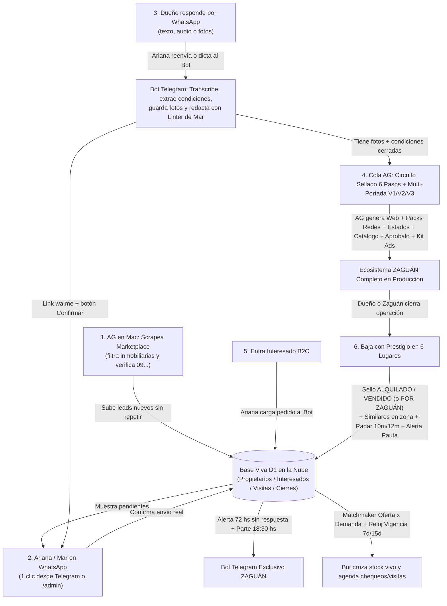

# PLAN MAESTRO DE ARQUITECTURA Y OPERACIÓN · 1 - ZAGUÁN (`MASTER_PLAN_CRM_TELEGRAM.md`)

**Última actualización:** 21 de noviembre de 2026  
**Estado:** Aprobado por Ariana para ejecución en fases  
**Guía operativa de pruebas y comandos:** [LEEME_ARIANA_COMO_USAR_Y_PROBAR.md](./LEEME_ARIANA_COMO_USAR_Y_PROBAR.md)

---

## Circuito Real de Proceso (AG en Mac ↔ Sistema en la Nube ↔ WhatsApp de Mar)

---

## LISTADO MAESTRO POR ORDEN DE IMPORTANCIA (8 PRIORIDADES)

### PRIORIDAD 1 · Base de Datos Viva Única en la Nube (El Corazón del CRM)
*Realidad actual:* Hoy `https://zaguanpropiedades.com/admin/` no es un CRM real; es una plantilla estática pegada a `prospeccion_viva_4zonas_zaguan.json` en GitHub que solo AG puede tocar desde la Mac y que no guarda conversaciones continuas.

- **1.A. Migración del JSON estático a Cloudflare D1 (Base Viva aislada para Zaguán):**
  - *Estado:* **YA SABEMOS CÓMO HACERLO** / **FALTA HACER:** Conectar la sesión de Cloudflare en esta Mac, crear las tablas e importar todos los contactos activos (dueños directos `MP-01` a `MP-39+`, desarrolladoras `PD`, colegas `INM`) sin perder ningún dato.
- **1.B. Los 5 Carriles Obligatorios de Propietarios (Oferta):**  
  `1. Por contactar` $\rightarrow$ `2. Esperando respuesta (reloj 72h)` $\rightarrow$ `3. En conversación / Pidiendo fotos y condiciones` $\rightarrow$ `4. Ficha activa en web` $\rightarrow$ `5. Cerrados / Radar futuro`.
  - *Estado:* **YA SABEMOS CÓMO HACERLO** / **FALTA HACER:** Actualizar la interfaz `/admin/` para mostrar estos 5 carriles e historial cronológico por contacto.
- **1.C. Los 3 Carriles Nuevos de Negocio Inmobiliario (`Interesados B2C`, `Visitas`, `Cierres / Escribanía`):**
  - *Estado:* **YA SABEMOS CÓMO HACERLO** / **FALTA HACER:** Crear tablas de Demanda (zona, tope en \$U/USD, dormitorios, garantía Porto/Sura/Mapfre/Santander/ANDA, mascota, fecha de ingreso), Visitas y Cierres/Señas/Honorarios.
- **1.D. Compatibilidad futura con Aprobalo ERP (sin mezclar redes hoy):**  
  Nace como servicio propio de Zaguán en Cloudflare para no tocar ni arriesgar el publicador de redes de Aprobalo, pero estructurado con el mismo `cuenta_id` (`0d9bb9b9-5348-4a2a-a0c9-b5ca64f9c5cb`).
  - *Estado:* **YA SABEMOS CÓMO HACERLO** / **FALTA PENSAR (a futuro):** Empaquetado como módulo ERP para terceros.

---

### PRIORIDAD 2 · Bot Personal Exprés de Zaguán en Telegram (Operación 24/7 desde el Celular)

- **2.A. Candado de Seguridad estricto por Usuario (`chat_id`):**  
  El bot responde únicamente al `chat_id` autorizado de Ariana (y de Mar si se habilita). Bloquea en silencio a cualquier extraño.
  - *Estado:* **YA SABEMOS CÓMO HACERLO** / **FALTA TENER:** Token de `@BotFather` + `chat_id` de Ariana.
- **2.B. Consultas en vivo y cambios de estado por texto o audio libre:**  
  Consultar pendientes, teléfonos, respuestas previas o cambiar estados con la Mac apagada.
  - *Estado:* **YA SABEMOS CÓMO HACERLO** / **FALTA HACER Y PROBAR:** Desplegar webhook en Worker y probar 5 consultas reales.
- **2.C. Reenvío directo de Audios y Fotos de WhatsApp al Bot:**  
  Al reenviar un audio o fotos que envió un propietario por WhatsApp, el bot transcribe el audio, extrae canon, gastos comunes, consumos, garantías y mascotas, y archiva las fotos en el contacto correspondiente.
  - *Estado:* **YA SABEMOS CÓMO HACERLO** / **FALTA PROBAR:** Validación con audio real de un propietario.
- **2.D. Desambiguación automática de homónimos (Caso *Anabela* x2 / *Ruiz* x2):**  
  Ante cualquier coincidencia múltiple en nombres o apellidos, el bot frena y muestra botones táctiles con barrio y teléfono antes de escribir o cerrar.
  - *Estado:* **YA SABEMOS CÓMO HACERLO** / **FALTA PROBAR:** Prueba con homónimos reales cargados.
- **2.E. Linter Obligatorio de Mar + Copys Completos + Botón `wa.me` + Cero Estado Prematuro:**  
  1. Cero `¿` ni `¡` de apertura (solo `?` y `!` de cierre).
  2. Cero adverbios terminados en `-mente`.
  3. Prohibida la palabra *"encajar"*.
  4. Prohibido mencionar `%`, meses ni comisiones en el primer mensaje.
  5. Prohibido inventar visitas o prometer muestras cuando todavía no existe ficha ni fotos.
  6. Todo borrador se entrega completo (cero recortes con `...`) y un lead pasa a `enviado` únicamente tras confirmación explícita (`[✅ Ya lo mandé]`).
  - *Estado:* **YA SABEMOS CÓMO HACERLO** / **FALTA HACER:** Fijarlo en reglas locales hoy y en código del Worker en Fase 1.

---

### PRIORIDAD 3 · Regla de Prestigio en Propiedades Cerradas + Baja Multicanal

- **3.A. Los 4 Sellos Reales de Cierre en Web (Prohibido borrar URLs):**
  - Cerró ZAGUÁN: **`ALQUILADO POR ZAGUÁN`** / **`VENDIDO POR ZAGUÁN`**.
  - Cerró dueño u otro: **`ALQUILADO`** / **`VENDIDO`**.
  - La URL y la tarjeta siguen visibles con transparencia real para sostener SEO/GEO y dar prestigio de movimiento de cartera; se apaga el CTA directo de esa unidad y se reemplaza por **"Consultar propiedades similares en la zona"**.
  - *Estado:* **HECHO EN ROSARIO (`Ref. ZAG-ALQ-06`)** / **YA SABEMOS CÓMO AUTOMATIZARLO CON D1 EN FASE 2**.
- **3.B. Freno y Alerta Multicanal al Cerrar (`Web`, `Meta/IG`, `Google Search`, `Aprobalo`, `WhatsApp`):**  
  Cada propiedad registra `canales_activos`. Al marcar cierre:
  1. Web pasa al sello correspondiente.
  2. Telegram dispara alerta inmediata si hay pauta activa en Meta/IG Directo o Google Search Ads para pausarla en el acto.
  3. Aprobalo Cloud frena posteos futuros de disponibilidad o los reemplaza por pieza social con `faja_seguridad_alquilado.svg`.
  4. `00_ESTADOS_WHATSAPP_LISTOS/` y `01_CATALOGO_WHATSAPP_BUSINESS/` marcan la unidad como cerrada para evitar subirla como disponible.
  - *Estado:* **YA SABEMOS CÓMO HACERLO** / **FALTA HACER:** Agregar campo `canales_activos` por propiedad en la base viva.

---

### PRIORIDAD 4 · Relojes de Retención, Embudo Anti-Trabajo en Vano y Matchmaker

- **4.A. Radar de 10 Meses en Alquileres Anuales Cerrados:**  
  Todo alquiler anual cerrado (por Zaguán o por el dueño, ej. Rosario) agenda alerta automática a `+10 meses` para recaptar 60 días antes del vencimiento del contrato.
  - *Estado:* **APLICADO EN ROSARIO (`2027-09-21`)** / **FALTA AUTOMATIZAR EN WORKER**.
- **4.B. Radar de 12 Meses en Ventas Cerradas o Pausadas:**  
  Toda venta cerrada o retirada temporalmente (ej. Emilia Levy) agenda alerta automática a `+12 meses` para retomar contacto.
  - *Estado:* **APLICADO EN EMILIA (`2027-11-17`)** / **FALTA AUTOMATIZAR EN WORKER**.
- **4.C. Embudo Rotativo en Fichas Activas (`7 días` alquiler / `15 días` venta):**  
  Para no quemar credibilidad repitiendo visitas inexistentes ni trabajar gratis si ya se alquiló:
  - *Toque A (Semana 1):* Consulta de filtro puntual (*"Nos consultó una pareja con Sura para ingresar el 1° del mes próximo, ¿lo contemplás?"*).
  - *Toque B (Semana 2):* Control corto de vigencia (*"Seguimos filtrando consultas con garantía para tu ficha; te chequeo corto para no mover en vano: ¿sigue disponible igual, verdad?"*).
  - *Con interesado firme:* Coordinación real de día y horario de visita.
  - *Estado:* **APLICADO EN JORGE (`2026-11-24`)** / **FALTA AUTOMATIZAR EN WORKER**.
- **4.D. Matchmaker (`Oferta x Demanda`) + Parte Diario 18:30 hs:**  
  Cruce instantáneo al cargar interesado o propiedad, y resumen único diario a las 18:30 hs en Telegram (respondieron hoy, vencen 72 hs, toques de vigencia 7/15d, visitas de mañana y tickets abiertos de `cola_ag`).
  - *Estado:* **YA SABEMOS CÓMO HACERLO** / **FALTA HACER Y PROBAR**.

---

### PRIORIDAD 5 · Circuito de Retroalimentación AG (Mac) ↔ Telegram (Nube)

- **5.A. Cola `cola_ag` con Acuse de 3 Estados (`⏳ PENDIENTE_AG` $\rightarrow$ `🔄 EN PROCESO` $\rightarrow$ `✅ HECHO REAL`):**  
  Todo pedido que requiere la Mac (scraping en Marketplace con Comet, generación de ficha HTML + `packs-redes` + MP4 y push a GitHub) queda guardado con número de ticket en `cola_ag`. Al abrir este chat en la Mac, AG lee la cola en primer término; al terminar de verdad, marca `HECHO_AG` y notifica de vuelta a tu Telegram. Todo ticket abierto reaparece en el Parte Diario de las 18:30 hs hasta resolverse.
  - *Estado:* **YA SABEMOS CÓMO HACERLO** / **FALTA HACER**.

---

### PRIORIDAD 6 · "ANEXO PROPIETARIOS" en el Sitio Web (`/propietarios/?id=...`) — En Gateras para Fase 2

- **6.A. Vista previa privada de 4 bloques por dueño:**  
  1) Galería de fotos elegidas (con portada principal), 2) Precio y moneda, 3) Gastos comunes y consumos, 4) Garantías habilitadas y plazo.
- **6.B. Acuerdo Básico de 1 Clic (Sin Exclusividad + Compromiso de Aviso):**  
  Botón `[✅ Acepto las condiciones y apruebo publicar mi ficha]`:
  - Autoriza el uso de fotos y datos sin exclusividad.
  - Reconoce honorarios tradicionales únicamente ante cierre con interesado presentado por Zaguán.
  - Obligación expresa de avisar apenas cierre por su cuenta mediante el botón `[🛑 Ya la alquilé / vendí por mi cuenta]` dentro del mismo link.
- **6.C. Evolución futura a Exclusividad:**  
  Segunda pestaña opcional para propietarios que elijan plan con exclusividad, pauta paga incluida y prioridad de portada.
  - *Estado:* **DISEÑO CERRADO EN GATERAS** / **FALTA HACER (Fase 2 posterior al Bot)**.

---

### PRIORIDAD 7 · Circuito Fáctico Sellado de Ficha (6 Pasos + Multi-Portada `V1 / V2 / V3`) + Kit IG Directo

Ninguna ficha se da por terminada hasta completar estos **6 eslabones** (y su circuito inverso al cerrar):

1. **Web + SEO/GEO:** HTML en `/alquileres/<slug>/index.html` (encabezado PNG oficial que conmuta fondo Hueso + logo negro al scrollear, visor táctil con flechas `<` `>` y swipe al tocar cualquier miniatura, mapa catastral en tierra firme, cero notas de cocina en vidriera), tarjeta en `/alquiloanual/` y `/alquileres/`, alta en `sitemap.xml` y `llms.txt` + URL lista para Search Console.
2. **Fábrica de Redes con Multi-Portada `V1 / V2 / V3` (`/Desktop/ZAGUAN CLAUDE/packs-redes/<slug>/`):**
   - **3 Variantes de Portada obligatorias (`V1` Interior principal, `V2` Exterior/Fachada/Deck, `V3` Cocina/Detalle)** para evitar piezas repetidas al rotar semanalmente o en pauta.
   - Carrusel `4:5` (`1080×1350`), Story `9:16` (`1080×1920`) validada contra `fabrica/safezone.json`, Reel `9:16` de 15s (`fabrica/mk3.py` + audio oficial `audio/Zaguán coN DOS VUELTAS AL INICIO y zaguanpropiedades dicho Y FIN 15segs.wav`), `copys.txt` validado con `fabrica/lint_copys.py` (`Ref. ZAG-ALQ-XX` + los 3 datos filtro para Mar) y fila en `CANVA_BULK_ZAGUAN_ALQUILERES.csv`.
3. **Estados de WhatsApp (`/Desktop/ZAGUAN CLAUDE/00_ESTADOS_WHATSAPP_LISTOS/`):** JPG + MP4 vertical + bloque listo en `TEXTO_PARA_EL_ESTADO.txt`.
4. **Catálogo WhatsApp Business + Meta Commerce (`/Desktop/ZAGUAN CLAUDE/01_CATALOGO_WHATSAPP_BUSINESS/`):** Portada `1000×1000` + ficha en `CATALOGO_WHATSAPP_BUSINESS_ZAGUAN.md` + fila en `CATALOGO_META_COMMERCE_ZAGUAN.csv`.
5. **Aprobalo Cloud (`0d9bb9b9-5348-4a2a-a0c9-b5ca64f9c5cb`):** Carga y calendarización respetando cadencia (Martes 100% libre). Las correcciones y elección de portada hechas en Aprobalo alimentan el aprendizaje de cuenta.
6. **Kit de Salida a Pauta IG Directo (`ig-directo-real-estate`):** Copy con filtro de precio/garantía arriba + link `wa.me` con código + configuración (`Visit your website`, categoría `Housing`, radio 15 km, `Set duration` 5 días y corte a las 72 hs) + respuesta pública en comentarios.

---

### PRIORIDAD 8 · Candado Anti-Pisado entre Procesos + Ingeniería Futura (Pendings)

- **8.A. Candado de Bloqueo de Archivos entre Procesos y Subagentes:**  
  Mientras el CRM resida en `prospeccion_viva_4zonas_zaguan.json`, queda prohibido que dos chats o subagentes editen el JSON en simultáneo. Las fichas nuevas y `packs-redes/` trabajan siempre en sus propias subcarpetas aisladas y se integran al JSON en un único paso final verificado.
- **8.B. Pending Futuro 1 — Fichas Dinámicas desde Nube / Auto-Commit GitHub:**  
  Migrar fichas a lectura dinámica desde D1 (`/alquileres/ver?slug=...`) o dotar al Worker de un token acotado para actualizar HTML/precios desde Telegram sin abrir la Mac. *(Estado: **FALTA EXPLORAR EN FASE FUTURA**).*
- **8.C. Pending Futuro 2 — Puente Automático de Scraping sin Abrir Chat:**  
  Evaluar servicio local liviano en la Mac siempre encendida para leer `cola_ag` y fuentes complementarias públicas en la nube que no exijan sesión de Facebook. *(Estado: **FALTA EXPLORAR EN FASE FUTURA**).*
